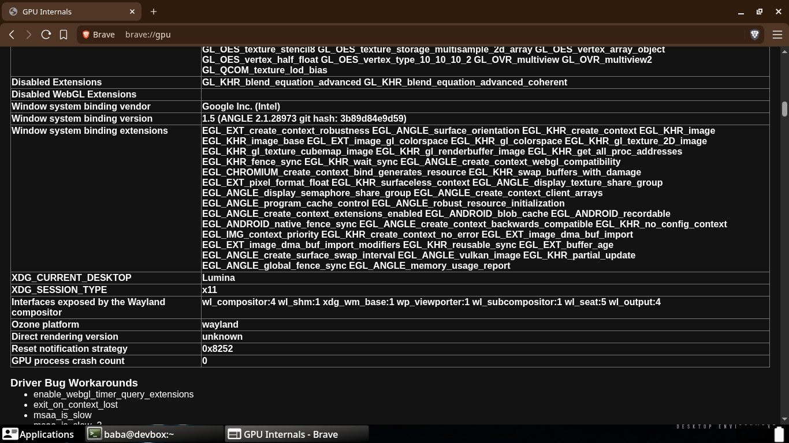
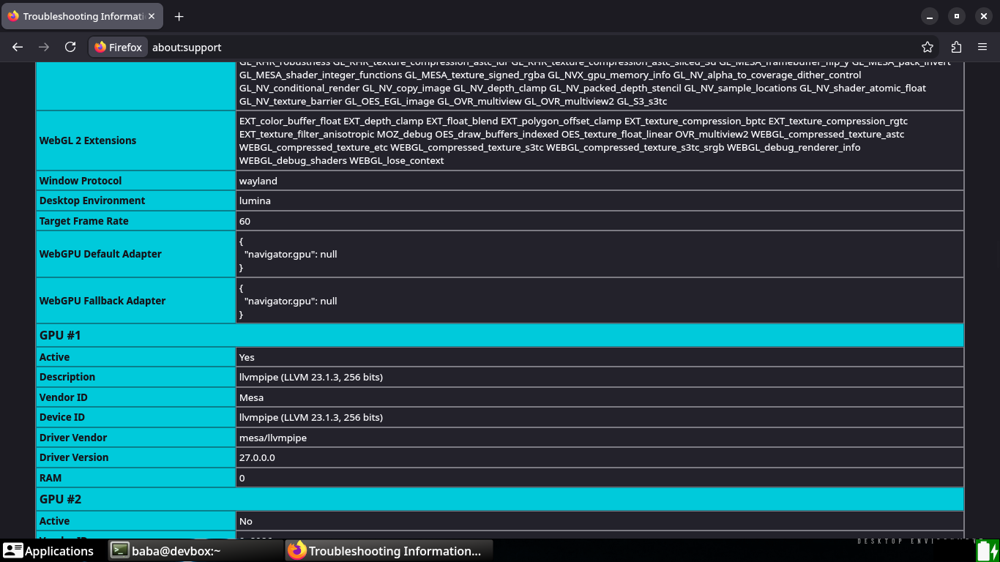
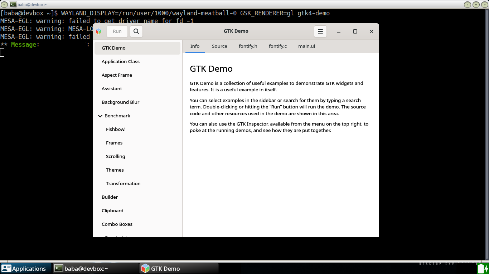
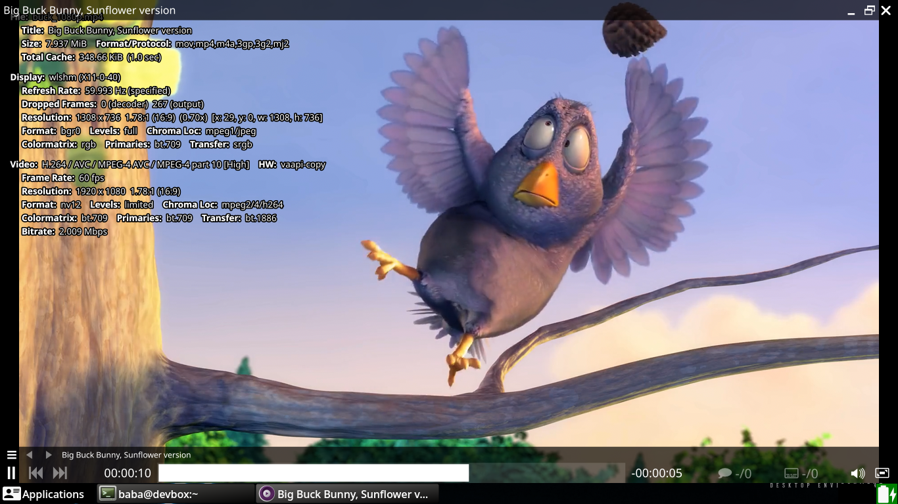

# Meatball.

A Wayland compatability layer that runs via the native X11 display server.


| | |
|:---:|:---:|
|  <br> **Chromium via Wayland on Meatball** |  <br> **Firefox via Wayland on Meatball** |
|  <br> **GTK4's Wayland backend on X11** |  <br> **MPV's `wlshm` backend on X11** |

## FAQ

### Will this work on [Xorg distribution here]?

Out of the box, no.

Meatball requires a set of patches that enables it to talk to Xorg directly and register external type clients to Xorg, who can then schedule and talk to them independently.


### What is the state of this project?

At the moment we support a Mimimum Viable Product set of Wayland features that enables
basic applications to function, these are applications that mostly rely on either software presentation or rendering through  `wl_shm`.

You should treat this project as alpha level of quality.

Expect bugs, crashes and data loss!

### How do I use this?

You need a copy of Spaghetti from [this branch](https://github.com/notbabaisyou/SpaghettiDev/tree/meatball) along with this repository.

```sh
meson setup src/builddir src -Dspaghetti_build_dir=/path/to/spaghetti/build
meson compile -C src/builddir
meson test -C src/builddir --print-errorlogs
```

To set it up, you need to put `libsauce.so` into `/usr/lib/xorg/modules` and add this
to your Xorg config.

```conf
Section "Module"
    SubSection "sauce"
        Option "SocketPath" "/run/user/1000/wayland-meatball-0"
        Option "SocketMode" "0600"
    EndSubSection
EndSection
```

After that you can use `WAYLAND_DISPLAY=/run/user/1000/wayland-meatball-0` to run your Wayland applications.

## License

```
Spaghetti Display Server
Copyright (C)       SpaghettiFork

This program is free software: you can redistribute it and/or modify
it under the terms of the GNU General Public License as published by
the Free Software Foundation, either version 3 of the License, or
(at your option) any later version.

This program is distributed in the hope that it will be useful,
but WITHOUT ANY WARRANTY; without even the implied warranty of
MERCHANTABILITY or FITNESS FOR A PARTICULAR PURPOSE.  See the
GNU General Public License for more details.

You should have received a copy of the GNU General Public License
along with this program.  If not, see <http://www.gnu.org/licenses/>.
```

Meatball was derived from 12to11, hence it's respective license
is included here.

```
12to11, a Wayland compositor running on top of an X server.
Copyright (C) 2022 to various contributors

This program is free software: you can redistribute it and/or modify
it under the terms of the GNU General Public License as published by
the Free Software Foundation, either version 3 of the License, or
(at your option) any later version.

This program is distributed in the hope that it will be useful,
but WITHOUT ANY WARRANTY; without even the implied warranty of
MERCHANTABILITY or FITNESS FOR A PARTICULAR PURPOSE.  See the
GNU General Public License for more details.

You should have received a copy of the GNU General Public License
along with this program.  If not, see <https://www.gnu.org/licenses/>.
```
